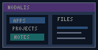

# Parcours utilisateur

## Besoin

Un seul workspace regroupant plusieurs applications et projets, avec accès immédiat aux notes, tâches, réunions, jalons et maintenances.

## Navigation

1. Naviguer dans le worktree et sélectionner un projet.
2. Ouvrir un document Markdown avec les liens `[[Architecture Nodalis]]`.
3. Chercher via Ctrl+F ou utiliser Ctrl+P pour une action métier.
4. Consulter l'accueil, les tâches consolidées, le calendrier et les vues transversales.
5. Relire les documents sources après avoir utilisé les projections.

## Points d'attention

La refonte du worktree #122 vise la lisibilité des en-têtes de projet et des boutons lors du défilement : voir la fiche [[Fiche de Maintenance]] du projet **Refonte explorateur 122**.

> Relation: documente | Cible: Architecture Nodalis | ID: bb000000-0000-4000-8000-000000000001
