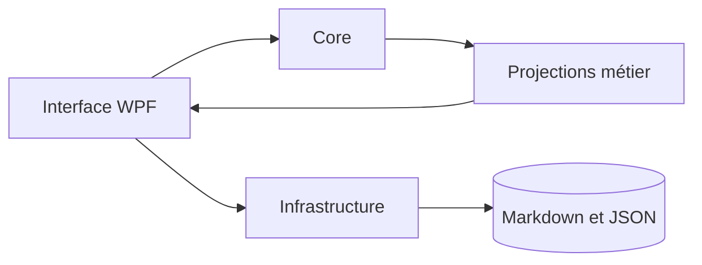

# Architecture Nodalis

## Principes

Nodalis est une application locale **WPF / C# / .NET 10**, sans service cloud obligatoire et sans package NuGet tiers. Le workspace est constitué de Markdown et JSON ; les projections de tâches, liens et vues ne réécrivent pas les sources.

## Couches

## Périmètre des versions

| Version | Capacité principale |
| --- | --- |
| 1.2 | incidents et interventions de maintenance |
| 1.4 | analyse d'impact |
| 1.5 | vues dynamiques |
| 1.6 | documents composites |
| 1.7 | recherche locale facultative prévue |

## Références

- [[Architecture des évolutions]]
- [[Spécification des liens]]
- [[Documents composites 1.6]]
- [Architecture du dépôt](https://github.com/TristanStark/Nodalis/blob/develop/docs/architecture.md)
