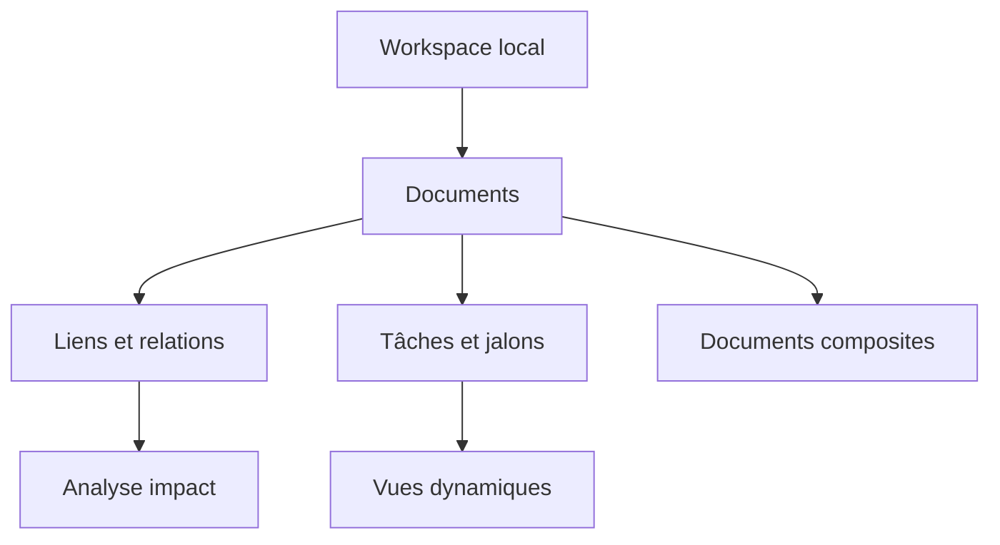

# Présentation 1.x

## Objectif

Illustrer le développement continu de **Nodalis**, gestionnaire de notes et de projets totalement local. Ce projet de démonstration couvre les livraisons historiques v1.2 à v1.6 et la préparation illustrative de la 1.7.

## Fonctionnalités et étapes

| Version | État au 18/10/2026 | Démonstration |
| --- | --- | --- |
| 1.2 | publiée | incidents, interventions, historique |
| 1.4 | publiée | analyse d'impact et graphe |
| 1.5 | publiée | vues dynamiques et filtres |
| 1.6 | publiée | documents composites |
| 1.7 | prévue / préparation | recherche lexicale locale, sans modèle IA obligatoire |

Voir [[Architecture des évolutions]], [[Spécification des liens]], [[Vues dynamiques 1.5]], [[Documents composites 1.6]].

## Travail d'équipe (scénario fictif)

- [x] Consolider les tests des documents composites | Responsable: Développement | Échéance: 2026-10-18 | Priorité: Haute | Statut: Terminé | Tags: release, regression
- [ ] Qualifier la navigation clavier des vues enregistrées | Responsable: Validation | Échéance: 2026-10-21 | Priorité: Normale | Statut: À faire | Tags: recette, ergonomie
- [ ] Préparer la recherche locale 1.7 | Responsable: Développement | Échéance: 2026-10-24 | Priorité: Haute | Statut: En cours | Tags: recherche, backlog
- [ ] Vérifier la reprise après erreur d'indexation | Responsable: Validation | Échéance: 2026-10-26 | Priorité: Haute | Statut: À faire | Tags: fiabilite, recette

## Coordination

Compte rendu illustratif : [[Réunion de planification]]. Décisions : [[Décision - Liens stables]] et [[Décision - Markdown canonique]].

## Carte d'ensemble

> Les lignes de suivi postérieures au 18 octobre sont simulées pour montrer tâches, dates et statuts.
