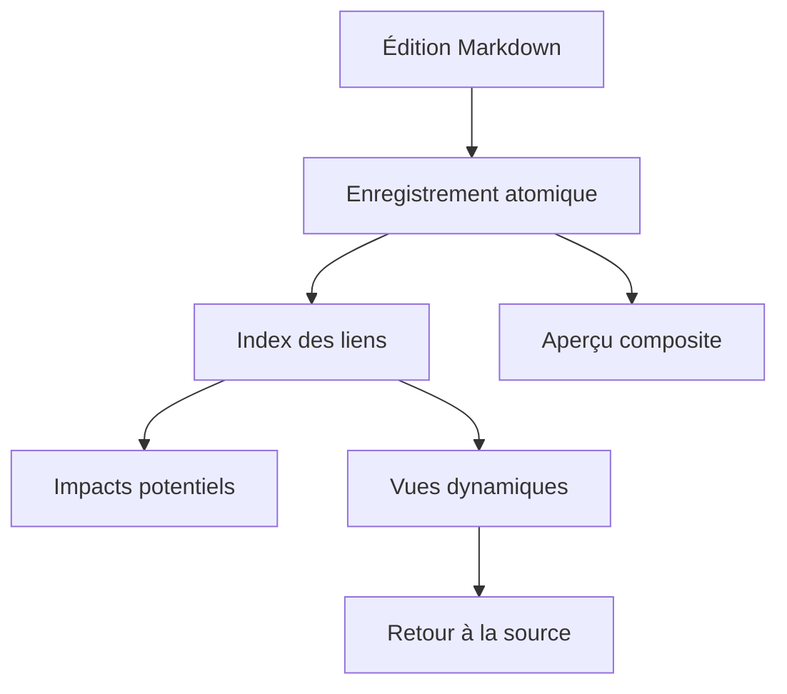

# Architecture des évolutions

## Contexte

Le workspace reste un dossier portable. Le registre `.nodalis-links.json` stabilise les IDs documentaires ; la projection de graphe et les vues sont dérivées des sources.

## Modules logiciels

- **Nodalis.App :** interface WPF, navigation, palette de commandes, éditeur.
- **Nodalis.Core :** modèles, contrats, index et règles de projection.
- **Nodalis.Infrastructure :** persistance atomique, import, backups et intégration du workspace.

## Flux d'une modification

## Risques

Une vue ou un graphe ne doit jamais devenir une seconde source de vérité. Les relations cassées restent explicitement signalées.

> Relation: dépend de | Cible: Spécification des liens | ID: bb000000-0000-4000-8000-000000000005

> Relation: documente | Cible: Décision - Markdown canonique | ID: bb000000-0000-4000-8000-000000000012

Voir [[Plan de recette]], [[Décision - Liens stables]], [[Risques et arbitrages]].
